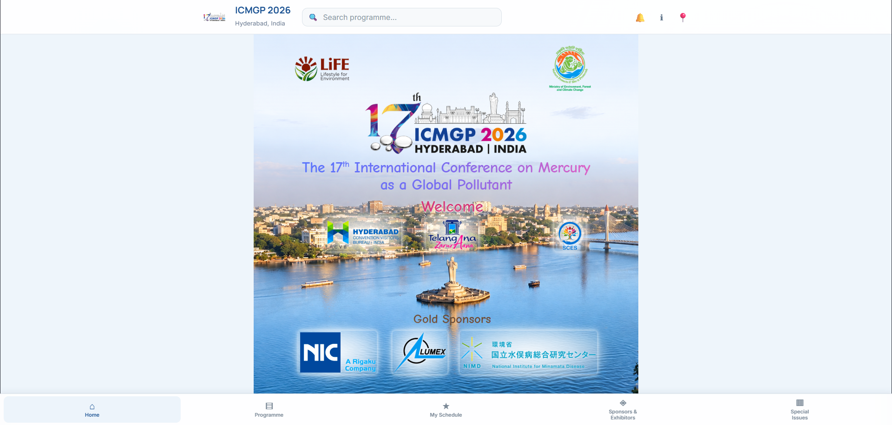

# ICMGP 2026 Conference App

Responsive web application for the **17th International Conference on Mercury as a Global Pollutant (ICMGP 2026)** in Hyderabad, India.

The app gives participants a searchable conference programme, presentation and workshop details, personal schedule bookmarking, announcements, venue links, sponsor information, special-issue information, and essential conference contacts. Programme content is loaded from an Excel workbook at runtime, so most schedule updates do not require rebuilding the interface.



## Contents

- [Main features](#main-features)
- [Technology](#technology)
- [Getting started](#getting-started)
- [Available commands](#available-commands)
- [How the app works](#how-the-app-works)
- [Updating app content](#updating-app-content)
- [Programme workbook](#programme-workbook)
- [Announcements](#announcements)
- [Project structure](#project-structure)
- [Deployment](#deployment)
- [Validation and testing](#validation-and-testing)
- [Troubleshooting](#troubleshooting)
- [Important implementation notes](#important-implementation-notes)

## Main features

- Responsive conference home page for phones, tablets, laptops, and desktop displays.
- Day-by-day programme with room columns, session blocks, breaks, workshops, awards, and special events.
- Detailed oral-presentation, poster, and workshop views.
- Programme search by title, abstract ID, presenter, co-author, session, room, and workshop information.
- Dedicated poster listing generated from the programme workbook.
- **My Schedule** bookmarking for sessions, presentations, posters, workshops, and events.
- Chronological sorting of saved items.
- Browser-local persistence of saved items between visits.
- Pinned announcements page and a popup announcement shown after the participant first leaves the home page.
- Sponsor, exhibitor, and journal-partner pages.
- Conference special-issue information and external publication links.
- Venue, convention centre, and guest house links that open in Google Maps.
- Quick information page with venue details, emergency numbers, and the conference secretariat email address.
- Central visual settings file for common fonts, colours, sizes, and layout values.
- Static deployment with no application server or database required.

## Technology

| Area | Technology |
| --- | --- |
| User interface | React 19 |
| Build tool and development server | Vite 8 |
| Programme parsing | SheetJS (`xlsx`) |
| Styling | Plain CSS with responsive breakpoints and CSS custom properties |
| State management | React hooks and context |
| Saved schedule storage | Browser `localStorage` |
| Hosting configuration | Vercel |
| Code checks | Oxlint |

The app has no backend, authentication system, or database. It reads public Excel and text files from the deployed site.

## Getting started

### Requirements

- Node.js `20.19.0` or newer in the Node 20 line, or Node.js `22.12.0` or newer.
- npm, included with Node.js.

### Install and run

```bash
git clone https://github.com/vikasm25/ICMGP_2026_WebApp.git
cd ICMGP_App_20260922-main
npm ci
npm run dev
```

Open the local URL printed by Vite, normally `http://localhost:5173`.

No environment variables are currently required.

## Available commands

| Command | Purpose |
| --- | --- |
| `npm run dev` | Validates the required programme workbook and starts the Vite development server. |
| `npm run build` | Validates the workbook and creates a production build in `dist/`. |
| `npm run preview` | Serves the production build locally for final checking. |
| `npm run lint` | Runs Oxlint from the repository root. See the lint note below. |
| `npm run prepare-programme` | Checks that the required refined programme workbook exists. |
| `node scripts/addPresentationSlots.mjs` | Maintenance utility that adds or fills presentation slot values in the refined workbook. It can rewrite the workbook, so commit or back it up first. |

`predev` and `prebuild` automatically run `prepare-programme`, preventing development or production builds when the main workbook is missing.

The current `lint` script has no ignore configuration. After dependencies are installed, it can also inspect `node_modules/` and generated files. For a source-only check, use:

```bash
npx oxlint src scripts vite.config.js
```

## How the app works

### Application flow

1. `src/main.jsx` mounts the React application.
2. `src/App.jsx` loads the programme, saved schedule, announcements, and visual settings.
3. `src/hooks/useProgrammeData.js` fetches the active Excel workbook.
4. The workbook parsers convert the Schedule, Workshops, oral-presentation, and poster sheets into application data.
5. `src/utils/programmeCorrections.js` applies final participant-facing schedule corrections.
6. `src/hooks/useProgrammeInteractions.js` connects sessions to presentation records, prepares search results, opens detail views, and sorts saved items.
7. `ConferenceContext` makes the shared application state available to pages and components.

### Data flow

```text
Excel workbook in public/
        |
        v
useProgrammeData
        |
        +--> scheduleParser ------> programmeCorrections
        +--> programmeParser -----> oral talks and posters
        +--> workshopParser ------> workshops
        |
        v
Programme UI, search, details, and My Schedule
```

Announcements follow a separate path:

```text
Pinned_Announcements.txt / Popup_Announcements.txt
        |
        v
useAnnouncements
        |
        v
Announcements page and popup
```

### Navigation

This is a single-page application with internal React state rather than URL-based routing. The main bottom navigation contains:

- Home
- Programme
- My Schedule
- Sponsors & Exhibitors
- Special Issues

Announcements, Quick Info, and Map are available from the header.

## Updating app content

| Content | File to edit |
| --- | --- |
| Main programme, workshops, oral talks, and posters | `public/FullProgramme_10_sept_2026_updated_Final_AQ_Refined.xlsx` |
| Active programme filename and public data paths | `src/utils/constants.js` |
| Final date-specific programme overrides | `src/utils/programmeCorrections.js` |
| Pinned announcements | `public/Pinned_Announcements.txt` |
| Popup announcements | `public/Popup_Announcements.txt` |
| Home page text, organisations, and featured sponsors | `src/pages/Home.jsx` |
| Sponsor and exhibitor sections | `src/pages/Sponsors.jsx` |
| Special-issue information | `src/pages/SpecialIssues.jsx` |
| Venue and map destinations | `src/pages/MapPage.jsx` |
| Quick information and emergency contacts | `src/pages/Info.jsx` |
| Static announcement cards such as Yoga and presentation guidance | `src/pages/Announcements.jsx` |
| Logos and images | `src/assets/` and `public/` |
| Common visual settings | `src/styles/visualSettings.js` |
| Detailed page styling | `src/CSS/` |

### Changing the active programme filename

The active workbook is configured in `src/utils/constants.js`:

```js
export const PROGRAMME_FILE =
  "/FullProgramme_10_sept_2026_updated_Final_AQ_Refined.xlsx";
```

If the workbook is renamed, update all of the following:

1. `PROGRAMME_FILE` in `src/utils/constants.js`.
2. `refinedProgrammePath` in `scripts/buildRefinedProgramme.mjs`.
3. `programmePath` in `scripts/addPresentationSlots.mjs`.

The filename must refer to a file inside `public/`. Vite copies public files into the production build unchanged.

### Date-specific corrections

Some final schedule changes are intentionally applied in code after the workbook is parsed. Review `src/utils/programmeCorrections.js` whenever a workbook edit appears correctly in Excel but not in the app.

For example, the **Women in Science Event on 5 October** is currently defined by the object with this ID:

```js
id: "05oct-women-in-science-event"
```

Its time, title, room, and description must be updated in `src/utils/programmeCorrections.js`. Changing only the old Women's Event row in the workbook will not replace this final participant-facing override.

Other date-specific display and presentation-count adjustments also exist in `src/utils/programmeCorrections.js`, `src/hooks/useProgrammeInteractions.js`, and `src/pages/Programme.jsx`. Keep these narrow corrections in mind when changing the final schedule.

## Programme workbook

The runtime workbook is:

```text
public/FullProgramme_10_sept_2026_updated_Final_AQ_Refined.xlsx
```

### Expected workbook structure

- `Schedule` — conference dates, times, room headings, session references, breaks, and special events.
- `Workshops` — workshop IDs, dates, times, rooms, titles, leads, descriptions, and speaker details.
- Topic/session sheets — oral and poster records, including session metadata, abstract IDs, titles, authors, presentation times, rooms, and optional slot values.

The parsers tolerate several workbook formatting variations, but sheet names, date values, schedule room headings, and presentation section headers should remain consistent.

### Workbook update checklist

1. Make a copy or commit the current workbook before editing it.
2. Edit the refined workbook in `public/`.
3. Keep its filename unchanged unless all three references described above are updated.
4. Confirm the `Schedule` and `Workshops` sheet names still exist.
5. Check whether the edited date or event has a code override.
6. Run `npx oxlint src scripts vite.config.js`.
7. Run `npm run build`.
8. Run `npm run preview` and manually check the affected day, search result, details modal, and My Schedule entry.

### Presentation-slot maintenance utility

`scripts/addPresentationSlots.mjs` matches counted session references in the Schedule sheet to session sheets. It adds or fills a `Slot` column for oral rows when needed. This utility directly writes to the refined workbook and is not run automatically by development or production builds.

Use it only when session occurrences or oral-presentation groupings require slot regeneration:

```bash
node scripts/addPresentationSlots.mjs
```

Review the workbook diff or manually inspect the changed sheets afterwards.

## Announcements

Announcements are maintained in two semicolon-separated text files:

- `public/Pinned_Announcements.txt` for cards on the Announcements page.
- `public/Popup_Announcements.txt` for the popup displayed when a user first leaves the home page during a visit.

Both files use this header:

```text
Announcement S.No;Date of Announcement;Priority;Title of Announcement;Content
```

Example:

```text
1;05 October 2026;High;Room change;Session ABC will now be held in Meeting Room 2.
```

Rules:

- Keep the header as the first line.
- Add one announcement per line.
- Lines beginning with `#` are ignored and can be used as comments.
- Separate fields with semicolons.
- Wrap a field in double quotes if it contains a semicolon.
- Escape a double quote inside a quoted field by writing it twice.
- Write `\n` inside Content to display a line break.
- The first field is used as the announcement ID and should be unique.
- If Priority is empty, the app uses `Normal`.
- Leaving only the header produces an empty dynamic-announcement list.

The files are requested without browser caching so newly deployed announcements can appear promptly.

## Visual customization

Use `src/styles/visualSettings.js` for common changes that should apply across the app. It controls:

- Main and heading fonts.
- Desktop and mobile base text sizes.
- Header, page title, programme, and navigation text sizes.
- Primary, background, text, surface, and border colours.
- Maximum content width.
- Bottom navigation height.
- Common corner radius.

`USE_CUSTOM_VISUAL_SETTINGS` enables or disables these runtime overrides. More specific layouts and responsive rules live in `src/CSS/`.

## Project structure

```text
.
|-- public/                     Runtime Excel, announcement, icon, and logo files
|-- screenshots/                Responsive screenshots used for review and documentation
|-- scripts/
|   |-- addPresentationSlots.mjs
|   `-- buildRefinedProgramme.mjs
|-- src/
|   |-- assets/                 Imported image assets
|   |-- components/             Header, navigation, popup, and detail modals
|   |-- context/                Shared conference context
|   |-- CSS/                    Page, component, modal, and responsive styles
|   |-- hooks/                  Programme, announcements, interactions, and saved schedule
|   |-- pages/                  Main application pages
|   |-- styles/                 Easy visual settings and runtime style injection
|   |-- utils/                  Parsers, date/time helpers, formatting, constants, corrections
|   |-- App.jsx                 Application composition and page navigation
|   `-- main.jsx                React entry point
|-- index.html                  Vite HTML entry point
|-- package.json                Dependencies and npm commands
|-- vercel.json                 Production cache headers
`-- vite.config.js              Vite configuration
```

Generated directories:

- `node_modules/` contains installed packages. Do not edit it manually or commit it to a new repository.
- `dist/` contains the production build. Recreate it with `npm run build`; do not make source changes there.

## Deployment

### Vercel

The repository includes `vercel.json`. To deploy with Vercel:

1. Import the GitHub repository into Vercel.
2. Use the Vite framework preset.
3. Use `npm run build` as the build command.
4. Use `dist` as the output directory.
5. No environment variables are required.
6. Deploy and check the programme workbook and announcement files in the production site.

The Vercel configuration sends `Cache-Control: no-store, max-age=0` for `/` and `/index.html`, reducing the chance that visitors receive an outdated application shell.

### Other static hosts

The app can be hosted on any service that serves the contents of `dist/` as a static site:

```bash
npm ci
npm run build
```

Upload the generated `dist/` directory. Because navigation is held in React state and does not create separate browser routes, no SPA fallback rewrite is currently required for page navigation.
